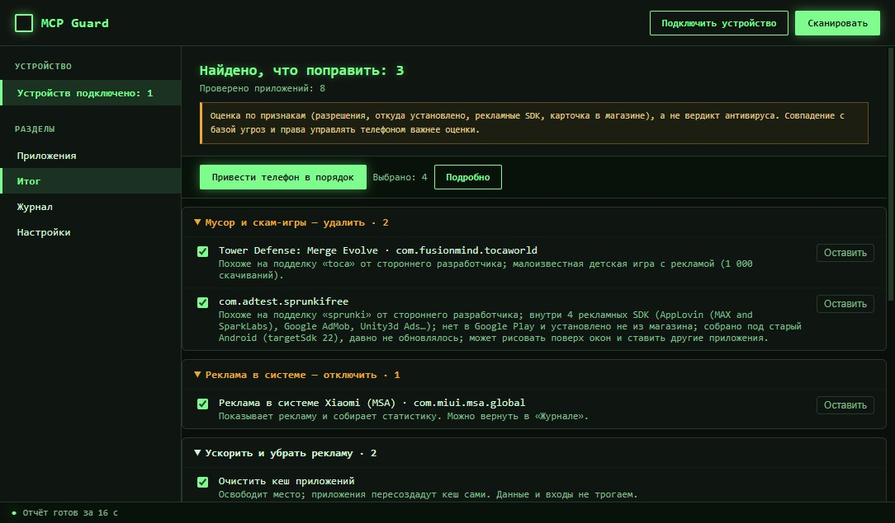
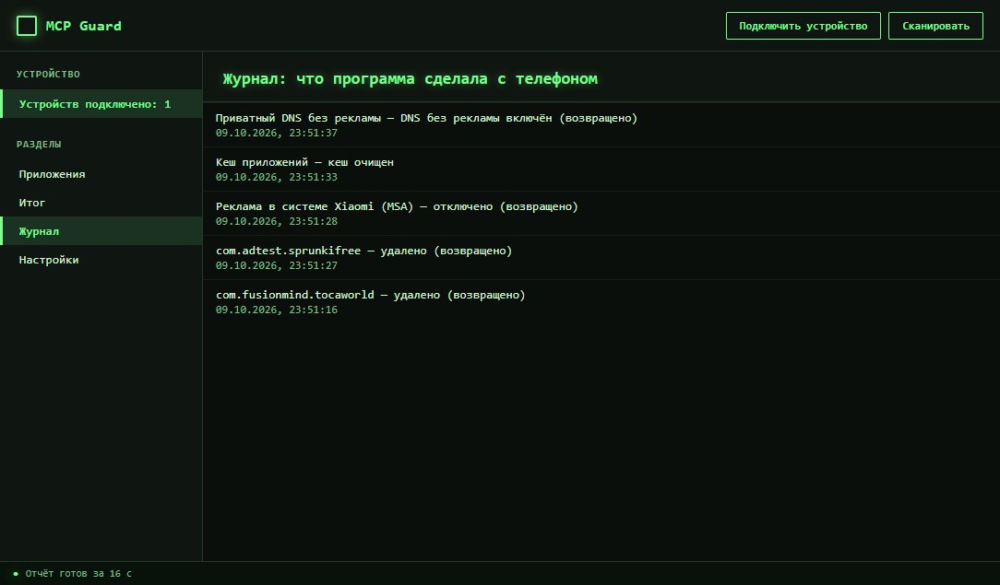

# MCP Guard

[Русский](#русский) · [English](#english)

Проверка Android-телефона с компьютера: вредоносные и шпионские приложения, скам-игры
для детей, реклама в прошивке, лишнее от производителя. Программа для Windows,
телефон подключается по USB.

Сайт и готовый установщик: **https://mcpteam.ru/mcpguard/**
Сделано в [MCPteam](https://mcpteam.ru): сайты, приложения и программы на заказ.



## Русский

### Что делает

- Читает с телефона список сторонних приложений через `adb`: разрешения, откуда
  установлено, SHA-256 APK, рекламные SDK внутри APK.
- Оценивает их прямо на компьютере по правилам и встроенным базам угроз. Нейросетей
  и облачного анализа нет, отчёт строится без интернета.
- Делит находки на группы: «Опасное — удалить», «Мусор и скам-игры — удалить»,
  «Реклама в системе — отключить», «Будят телефон в фоне», «Проверьте сами».
- Приводит телефон в порядок по одной кнопке: удаляет выбранное, отключает рекламные
  службы прошивки, чистит кеш, по желанию включает приватный DNS без рекламы.
- Всё обратимо: перед удалением APK копируется на компьютер, а в «Журнале» есть
  кнопка «Вернуть как было».



Оценка — это эвристика по признакам, а не вердикт антивируса. Совпадение с базой
угроз и права управлять телефоном (администратор, спецвозможности, показ поверх окон)
весят больше, чем баллы правил.

### Как собрать

Нужны Windows, Node.js 20+ и телефон с включённой отладкой по USB
(Настройки → Для разработчиков).

```
npm install
npm run setup:adb   # один раз: скачивает Android platform-tools в resources/bin
npm start           # запуск из исходников
npm run dist        # установщик NSIS в dist/
```

Проверки: `node test/rules.check.js`, `node test/tidy.check.js`, `node test/data.check.js`.
С подключённым эмулятором: `node test/live.check.js`.

Базы угроз в `src/data/` пересобирает `python scripts/build-data.py` (только stdlib).

### Сервер (необязателен)

`backend/` — FastAPI + SQLite. Клиенту он нужен только за карточками Google Play
(`POST /play`), без него отчёт всё равно строится. Адрес сервера задаётся в
«Настройках» программы, пример окружения — `backend/.env.example`.

### Лицензия

Код — MIT. Данные в `src/data/` собраны из открытых источников и остаются под их
лицензиями (Exodus Privacy, stalkerware-indicators, mvt-indicators, MalwareBazaar,
UAD-ng), подробности в [NOTICE](NOTICE).

## English

MCP Guard checks an Android phone from a Windows PC over USB. It finds malware and
stalkerware, scam games installed by kids, firmware ads and vendor bloat, and cleans
the phone up in one click.

- Reads third-party apps via `adb`: permissions, installer, APK SHA-256, ad SDKs
  inside the APK.
- Scores them locally with rules and bundled threat databases. No AI and no cloud
  analysis, works offline.
- Removes or disables what you select, clears caches, optionally sets an ad-blocking
  private DNS. Everything is reversible: APKs are backed up before removal and the
  Journal has an "Undo" button.

The score is a heuristic, not an antivirus verdict. A threat database match or device
control rights (device admin, accessibility, overlay) outweigh the rule score.

### Build

Windows, Node.js 20+, a phone with USB debugging enabled.

```
npm install
npm run setup:adb   # once: downloads Android platform-tools into resources/bin
npm start           # run from source
npm run dist        # NSIS installer in dist/
```

Checks: `node test/rules.check.js`, `node test/tidy.check.js`, `node test/data.check.js`.

The optional `backend/` (FastAPI + SQLite) only serves Google Play cards; the report
works without it.

Code is MIT-licensed; threat data keeps the licenses of its sources, see [NOTICE](NOTICE).

Download and website: https://mcpteam.ru/mcpguard/ · Built by [MCPteam](https://mcpteam.ru).
